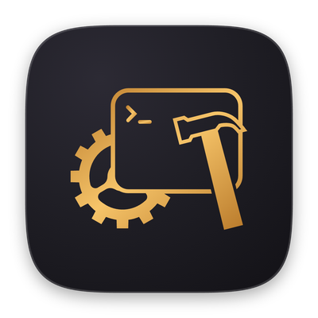
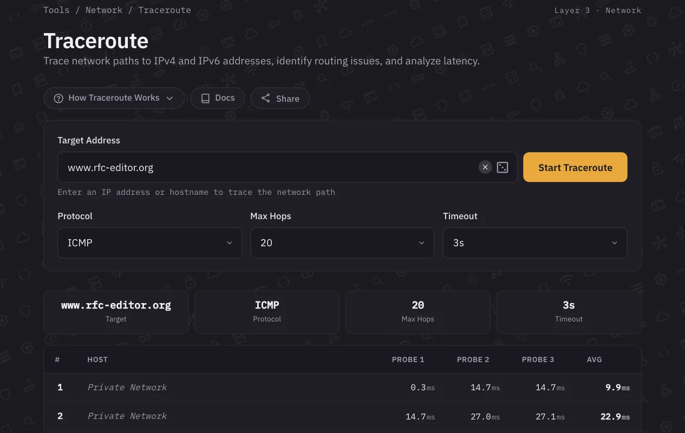

<p align="center">
<a href="https://troubleshooting.tools/check/traceroute"></a>
</p>

<h1 align="center">Traceroute</h1>

<p align="center">Follow the path to a host hop by hop, live as each router answers.</p>

<p align="center"><a href="https://troubleshooting.tools/check/traceroute"><b>Open the tool</b></a> &nbsp;·&nbsp; <a href="https://troubleshooting.tools/docs/traceroute">Documentation</a> &nbsp;·&nbsp; <a href="https://disisto.de/project-traceroute">Project page</a></p>

<p align="center"></p>

## Contents

- [Features](#features)
- [On the web page](#on-the-web-page)
- [Links you can share](#links-you-can-share)
- [Choosing a protocol](#choosing-a-protocol)
- [Reading the hops](#reading-the-hops)
- [The stream from the API](#the-stream-from-the-api)
- [Recipes](#recipes)
- [Privacy](#privacy)
- [Good to know](#good-to-know)

## Features

- Probes with ICMP, UDP or TCP, so a path can still be traced when one of them is filtered along the way.
- Hops appear one by one while the trace runs, not as one block at the end.
- Each hop shows its address, its reverse DNS name, up to three probe times and their average.
- Hops where only some probes went unanswered are marked separately from hops that stayed silent.
- Hop addresses open the IP lookup, host names open the DNS lookup.
- A summary at the end gives the hop count and the lowest, average and highest latency.
- An API that streams the same hops as JSON lines, readable live with `curl -N`.

## On the web page

1. Open <https://troubleshooting.tools/check/traceroute>.
2. Enter a host name, an IPv4 or an IPv6 address, for example `www.rfc-editor.org`.
3. Set **Protocol** (ICMP, UDP or TCP), **Max Hops** (15, 20 or 30) and **Timeout** per hop (2, 3 or 5 seconds).
4. Press **Start Traceroute** and watch the hops arrive; **Stop** ends the trace on the server early.

Above the table the page repeats target, protocol, hop limit and timeout. The table has one row per hop:

| Column | Content |
|---|---|
| **#** | distance from the server, starting at 1 |
| **Host** | address and reverse DNS name, each a link to the IP or DNS lookup; private hops show a label such as *Private Network* |
| **Probe 1–3** | round-trip time of each probe, or a mark for no answer |
| **Avg** | the mean of the answered probes |

When the trace ends, a summary shows **Hops**, **Avg Latency**, **Min** and **Max**.

## Links you can share

A link with the target starts the trace as soon as it is opened:

| Target | Link |
|---|---|
| Host name | <https://troubleshooting.tools/check/traceroute/www.rfc-editor.org> |

Protocol, hop limit and timeout are not part of the link; the page uses its defaults (ICMP, 20 hops, 3 seconds). Links of the older form `/lookup/traceroute/…` redirect to this one.

## Choosing a protocol

| Protocol | How it probes | Try it when |
|---|---|---|
| **ICMP** | echo requests with rising TTL; the default | you want the most complete picture of a path |
| **UDP** | datagrams to high ports, the classic Unix way | ICMP is filtered somewhere |
| **TCP** | SYN packets, like the start of a normal connection | both of the others are dropped, typically on the way to a web server |

The same target traced with two protocols often shows different hops at the end, because firewalls treat the three kinds of packets differently.

## Reading the hops

| What you see | What it usually means |
|---|---|
| a hop with three times | the router answered every probe |
| a hop with one or two times and a gap | partial timeout: the router limits how often it answers, the path itself is fine |
| a hop with no answer at all | the router forwards traffic but does not reply to probes; harmless in the middle of a trace |
| no answers from some hop to the end | the path, or the target, is blocking or broken from there on |
| a label instead of an address | the hop is inside a private or reserved network; reverse names ending in `.local`, `.internal`, `.corp` or `.localdomain` show **Local Network** |

A trace stops as soon as the target answers, so it is usually much shorter than the hop limit. If it hits the hop limit or its run time runs out, the hops found so far are kept.

## The stream from the API

The API lives at `https://api.troubleshooting.tools/v1` and needs no key. A trace is a POST with a JSON body:

| Field | Values | Default |
|---|---|---|
| `target` | host name, IPv4 or IPv6 address | required |
| `protocol` | `icmp`, `udp`, `tcp` | `icmp` |
| `max_hops` | up to 30 | 20 |
| `timeout` | seconds per hop, up to 5 | 3 |

Values outside the allowed ranges are refused, not adjusted.

```sh
curl -sN -X POST https://api.troubleshooting.tools/v1/check/traceroute \
  -H "Content-Type: application/json" \
  -d '{"target": "www.rfc-editor.org", "protocol": "tcp"}'
```

The answer is a stream of JSON lines (`application/x-ndjson`), one record per line as the trace goes on. Each record has a `type`:

| `type` | When | Carries |
|---|---|---|
| `start` | first line | target, the address being traced, hop limit, timeout, protocol, and whether the target was a host name or an address |
| `hop` | once per hop | see below |
| `raw` | rarely | an output line the parser did not recognise, passed on as `line` |
| `complete` | last line of a finished trace | `total_hops` and `reached`, whether the target itself answered |
| `error` | instead of `complete` | `message`, starting with `Traceroute execution failed: ` when the trace could not run at all; it can then arrive without a `start` line before it |

A `hop` record holds `hop`, `ip`, `hostname` (when one resolved), `times` (one value per answered probe, in milliseconds) and `avg_time`. A hop that answered nothing has `"timeout": true` and no other fields; a hop where only some probes came back adds `partial_timeout` and `timeout_count`; a hop in a private network has `"private": true` in place of address and name.

The end of a real trace, shortened:

```json
{"type":"start","target":"www.rfc-editor.org","address":"104.18.20.81","max_hops":20,"timeout":3,"protocol":"tcp","target_type":"hostname"}
…
{"type":"hop","hop":6,"timeout":false,"ip":"198.41.240.13","times":[11.708,12.123,11.968],"avg_time":11.93}
{"type":"hop","hop":7,"timeout":false,"ip":"104.18.20.81","times":[11.55,11.592,11.469],"avg_time":11.54}
{"type":"complete","target":"www.rfc-editor.org","total_hops":7,"reached":true}
```

A wrong value is refused before the stream starts, with a real HTTP 400 and `{"success": false, "error": "..."}`:

```sh
curl -s -X POST https://api.troubleshooting.tools/v1/check/traceroute \
  -H "Content-Type: application/json" \
  -d '{"target": "www.rfc-editor.org", "protocol": "sctp"}'
# {"success":false,"error":"Protocol must be icmp, udp, or tcp."}
```

Other methods are refused (`OPTIONS` gets 204 for CORS preflight), too many traces from one address get HTTP 429, and a fully busy service HTTP 503. All messages are listed in the [documentation](https://troubleshooting.tools/docs/traceroute).

## Recipes

**Watch the hops arrive in the terminal**

Without `-N`, curl buffers the answer and prints everything at the end.

```sh
curl -sN -X POST https://api.troubleshooting.tools/v1/check/traceroute \
  -H "Content-Type: application/json" \
  -d '{"target": "www.rfc-editor.org", "protocol": "icmp", "max_hops": 20}'
```

**A readable table with jq**

```sh
curl -sN -X POST https://api.troubleshooting.tools/v1/check/traceroute \
  -H "Content-Type: application/json" \
  -d '{"target": "www.rfc-editor.org", "protocol": "tcp"}' \
  | jq -r --unbuffered 'select(.type=="hop") | "\(.hop)\t\(.ip // (if .private then "private" else "*" end))\t\(.avg_time // "*") ms"'
# …
# 6   198.41.240.13   11.93 ms
# 7   104.18.20.81    11.54 ms
```

**Did the trace reach the target?**

```sh
curl -sN -X POST https://api.troubleshooting.tools/v1/check/traceroute \
  -H "Content-Type: application/json" \
  -d '{"target": "www.rfc-editor.org", "protocol": "tcp"}' \
  | jq -r 'select(.type=="complete" or .type=="error") | if .type=="complete" then "reached=\(.reached) hops=\(.total_hops)" else "error: \(.message)" end'
# reached=true hops=7
```

**Find hops that drop some probes**

```sh
curl -sN -X POST https://api.troubleshooting.tools/v1/check/traceroute \
  -H "Content-Type: application/json" \
  -d '{"target": "www.rfc-editor.org"}' \
  | jq -r 'select(.type=="hop" and .partial_timeout) | "hop \(.hop): \(.timeout_count) of the probes unanswered"'
```

**When the trace stops in the middle**

Many networks drop ICMP or UDP probes. Run the same target again with `"protocol": "tcp"`; TCP probes towards a web server often get through where the others end in timeouts. Compare the result with a traceroute from your own machine to see where the two paths part.

## Privacy

- No account, no sign-up, no key.
- Every probe leaves from the server. Routers along the way and the destination only ever learn the server's address.
- For the rate limit your address is kept only as a keyed hash.
- No third-party content is embedded in the page.

## Good to know

- The trace maps the path from the server to the target, not from you; that makes it a second point of view next to your own traceroute.
- Routers that answer only some probes are often just rate limiting their replies; a broken path shows up as hops that stay silent to the end.
- A trace has an upper limit on hops and run time; when it is cut off, the hops found so far are kept.
- Traces run over IPv4. IPv6 addresses are accepted but cannot be traced.

---

<sub>Part of <a href="https://troubleshooting.tools">troubleshooting.tools</a>.</sub>
